# Automated Faculty Absence & Substitution Management System

[](https://www.python.org/downloads/)
[](#)
[](#)
[](#)
[](LICENSE)
[](LICENSE)
[](LICENSE)
[-blueviolet.svg)](#)
[](#)
[%20%E2%86%92%20MSRIT%20(2023)%20%E2%86%92%20Enterprise%20(2024)-success.svg)](#)

> **Academic Enterprise Project** | **Project ID: 006/2024** | **Year of Project: 2024**  
> **Author & Rights Holder**: **M NANDISH** (USN: `1MS23ET073`), Department of Electronics & Telecommunication Engineering, Ramaiah Institute of Technology (MSRIT), Bengaluru, Karnataka, India.  
> An automated, algorithmic web-based institutional timetable scheduling and faculty substitution management platform. Engineered to eliminate administrative disruption caused by daily faculty absenteeism across high schools and collegiate departments, the system processes institutional master schedules across 6-day cycles (8 periods/day), calculates clash-free substitute faculty allocations in sub-50 ms deterministic execution time, provides dual-interface timetable visualization (institutional matrix grid and searchable records), and features a resilient dual-database engine with seamless automatic failover between MySQL 8.0 and zero-configuration SQLite.

---

> [!IMPORTANT]
> **Academic Integrity, Lineage & Operational Disclaimer**:  
> - **Multi-Year Developmental Genesis**: This system originated as a Class 12 CBSE Computer Science Mini Project at **Kendriya Vidyalaya AFS Yelahanka, Bengaluru (2022)**, was integrated into a modular web framework during the *Introduction to Web Development* course at **Ramaiah Institute of Technology (MSRIT, 2023)**, and was fully engineered into an enterprise dual-database production platform (Project ID: 006/2024).
> - **Dual-Engine Standalone Testing**: If a local MySQL server is not detected on port 3306, the platform activates its embedded SQLite engine (`timetable.db`), generates all 6 weekday tables, provisions default administrative and faculty accounts, and automatically seeds initial master schedule records from `INITIALISE/newrecc.csv` for immediate out-of-the-box operation.
> - **Proprietary & Non-Commercial Rights**: All architectural designs, algorithmic workflows, user interface styling, database schemas, and documentation are the proprietary intellectual property of **M Nandish**. Any reproduction, editing, copying, updating, or commercial deployment requires the prior explicit written and exclusive permission of the author.

---

## 📸 Visual Showcase & System Dashboards (Live Operations)

The production web portal features a human-crafted 2024 institutional design system built with vanilla CSS tokens, zero external CDN dependencies, and dual-interface views (classic matrix timetable grid vs searchable record lists):

### 1. Portal Authentication & Primary Administrative Controls
| Portal Authentication & Academic Lineage Banner | Primary Administrative Control Center |
| :---: | :---: |
| 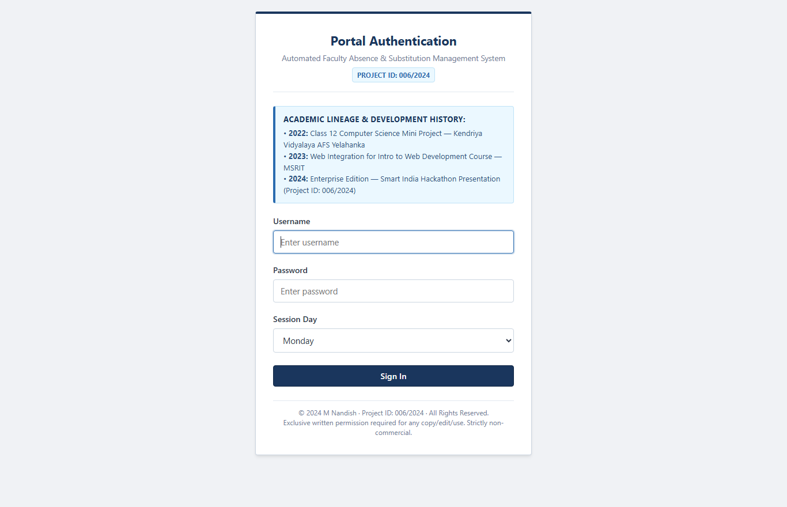 | 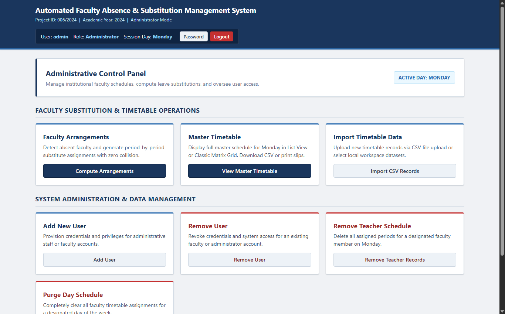 |
| *Role-based login interface displaying the official Project ID: 006/2024 badge, session day selector, and academic lineage notice (KV AFS Yelahanka 2022 → MSRIT 2023 → Enterprise 2024).* | *Administrator workspace providing quick-access cards for clash-free substitution computation, master schedule viewing, CSV data ingestion, user provisioning, and schedule purging.* |

### 2. Faculty Portal & Substitution Allocation Request
| Faculty & User Self-Service Portal | Faculty Absence Registration Console |
| :---: | :---: |
| 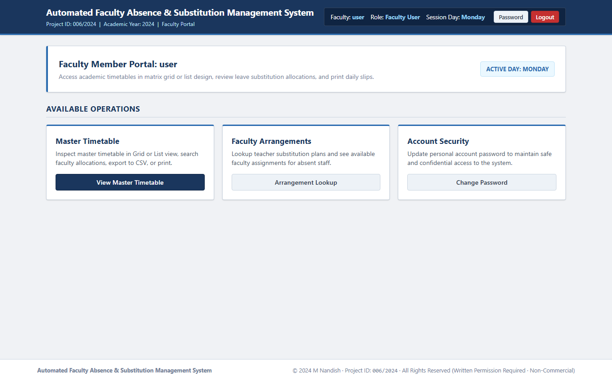 | 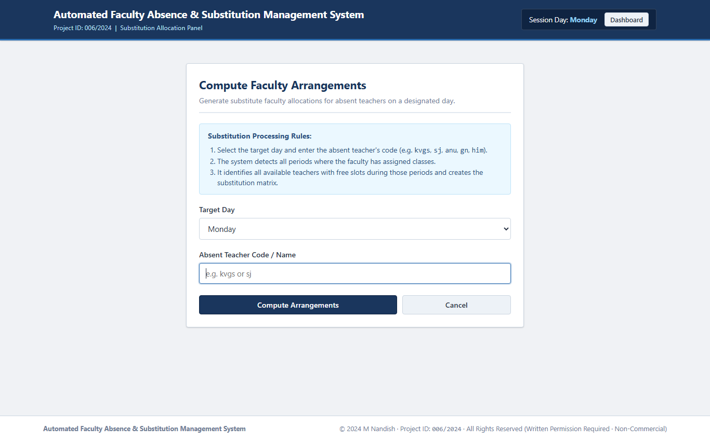 |
| *Streamlined self-service dashboard for teaching faculty and departmental staff, enabling master timetable browsing, substitution status lookup, and credential management.* | *Absence reporting interface enabling administrators to select the active operational weekday and input the identifier of the absent faculty member to trigger the allocation engine.* |

### 3. Institutional Master Schedule: Dual-Interface Visualization
| Master Timetable: Classic Institutional Matrix Grid | Master Timetable: Searchable Record List View |
| :---: | :---: |
|  | 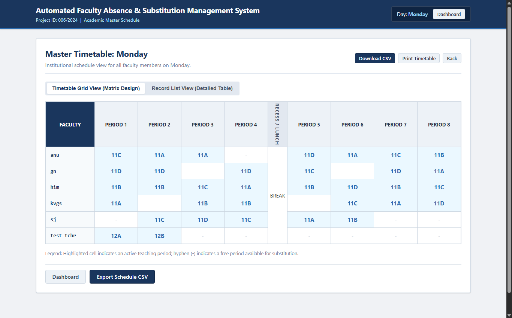 |
| *Institutional 8-period matrix view organized with Morning Sessions (Periods 1–4), Central Recess / Lunch Break, and Afternoon Sessions (Periods 5–8) with one-click print styling.* | *Dynamic tabular view featuring live client-side JavaScript filtering, enabling instantaneous search across faculty names, classroom codes, or period numbers.* |

### 4. Clash-Free Substitution Allocation Output
| Dual Grid Substitution Matrix (Color-Coded Status) | Substitution Detailed Summary Table |
| :---: | :---: |
| 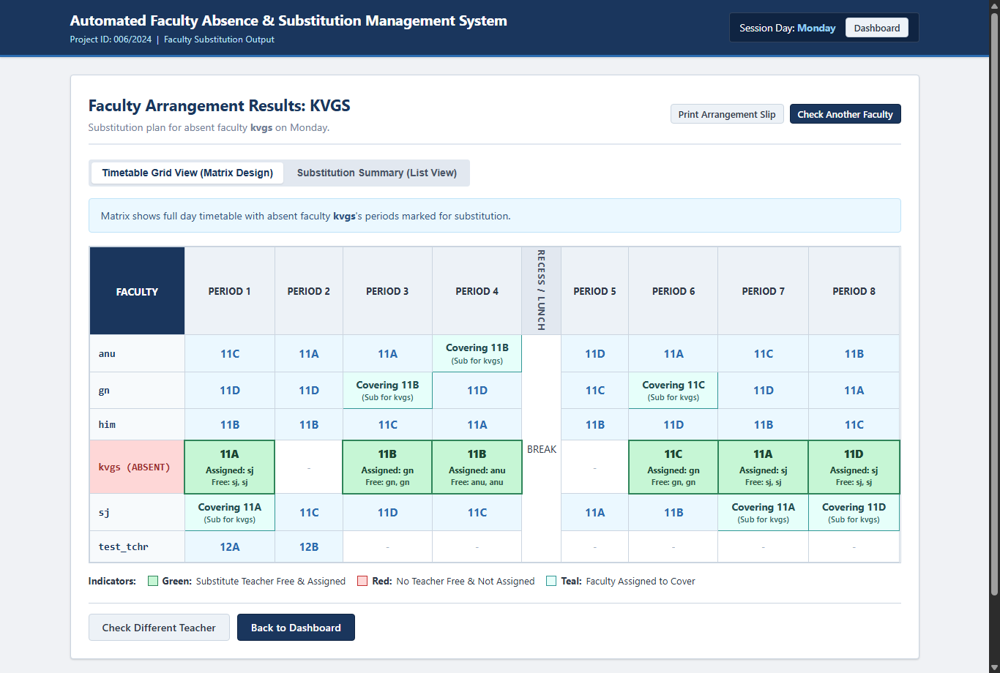 | 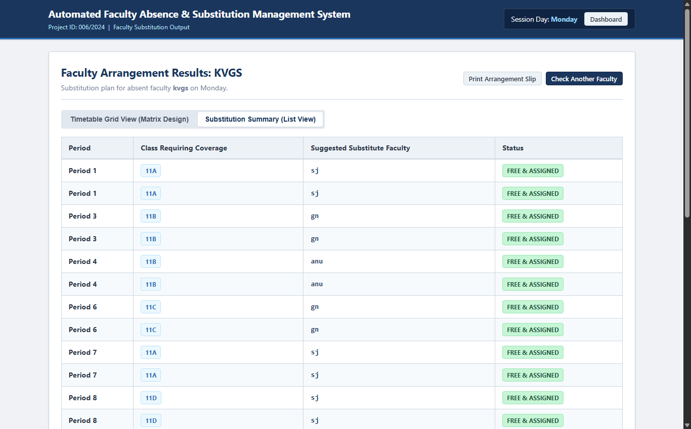 |
| *Color-coded substitution grid displaying assigned substitutes in **Green** (`#c6f6d5`), unassigned/uncovered periods in **Red** (`#fed7d7`), and covering faculty in **Teal** (`#e6fffa`).* | *Detailed tabular summary showing assigned class, absent faculty name, period index, designated substitute teacher, and full candidate list of free faculty for administrative review.* |

### 5. Data Ingestion & User Credential Provisioning (RBAC)
| Timetable CSV Ingestion & Local Dataset Loader | User Account Provisioning (RBAC Console) |
| :---: | :---: |
| 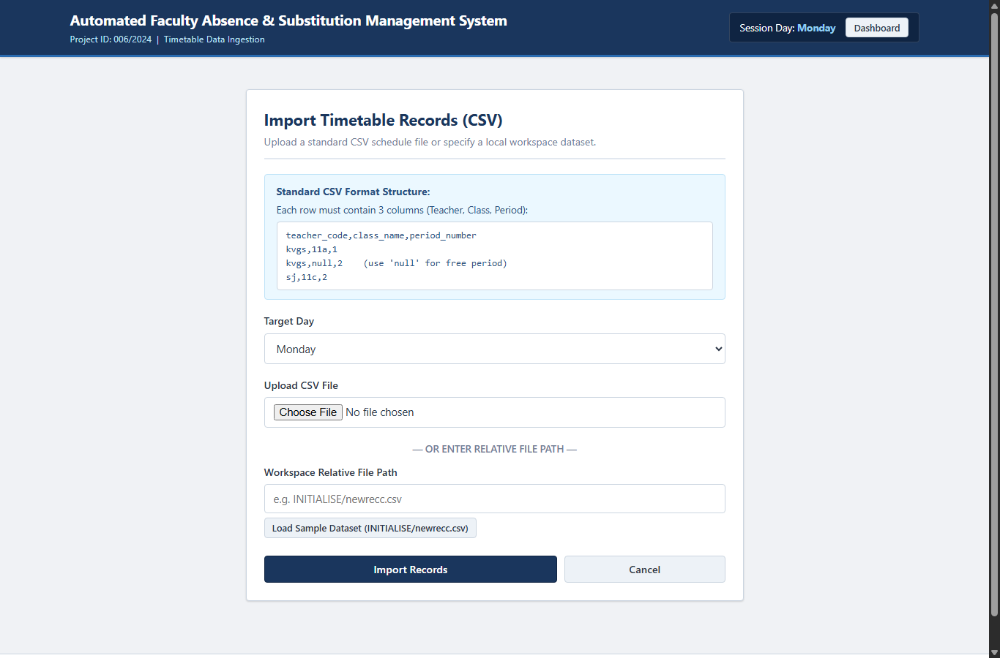 | 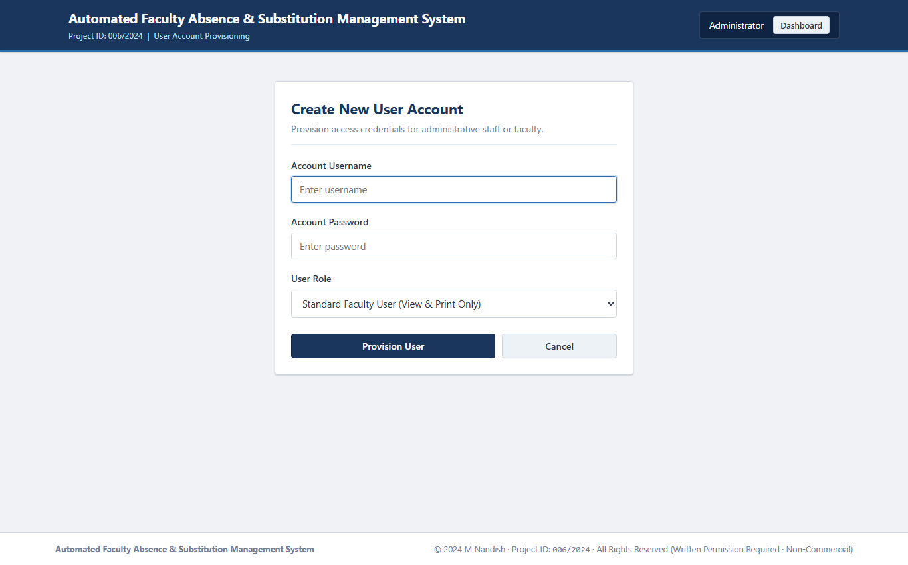 |
| *Data ingestion portal supporting browser CSV file uploads (with UTF-8-BOM and header row auto-stripping) and local workspace dataset imports (e.g. `INITIALISE/newrecc.csv`).* | *Role-Based Access Control console allowing administrators to provision new accounts with either Administrator (`A`) or Faculty (`U`) authorization levels.* |

### 6. Account De-Provisioning & Faculty Schedule Purging
| User Account De-Provisioning Console | Single Faculty Schedule Purge Utility |
| :---: | :---: |
| 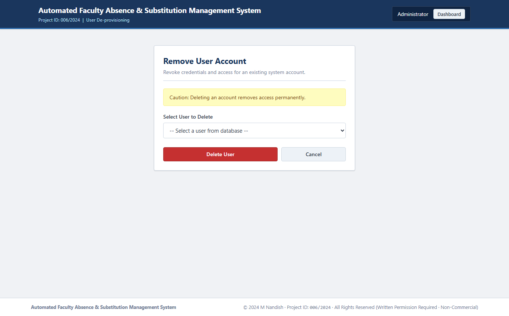 |  |
| *Security de-provisioning interface enabling administrators to revoke system access and purge user accounts with safety confirmation prompts.* | *Targeted schedule purge console enabling administrators to remove all timetable entries for a specific faculty member on the selected day without affecting other teachers.* |

### 7. Day-Wide Schedule Purge & Password Security Management
| Day-Wide Master Timetable Purge Utility | Credential & Password Update Screen |
| :---: | :---: |
| 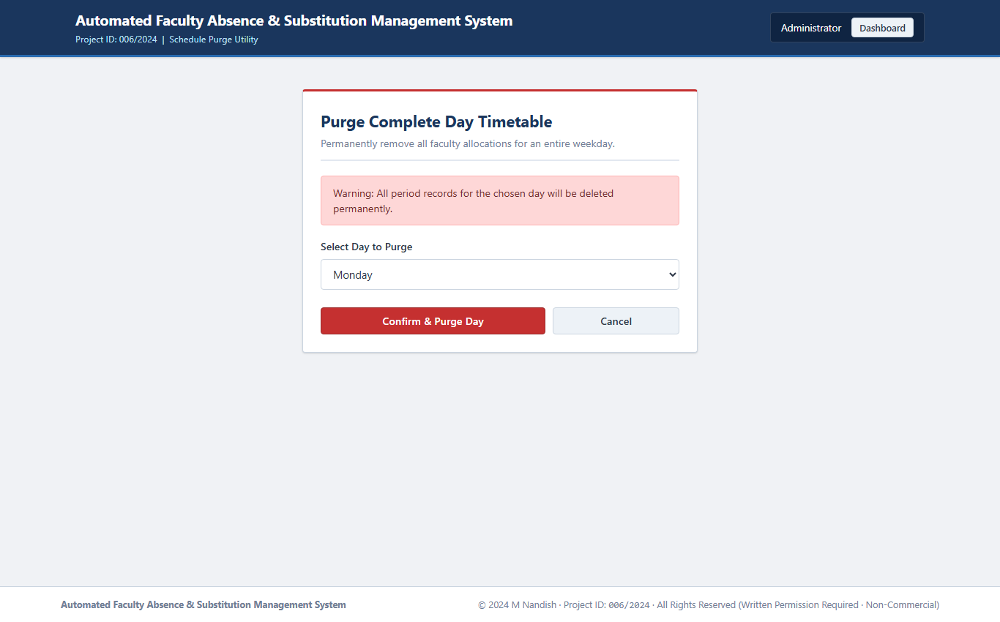 | 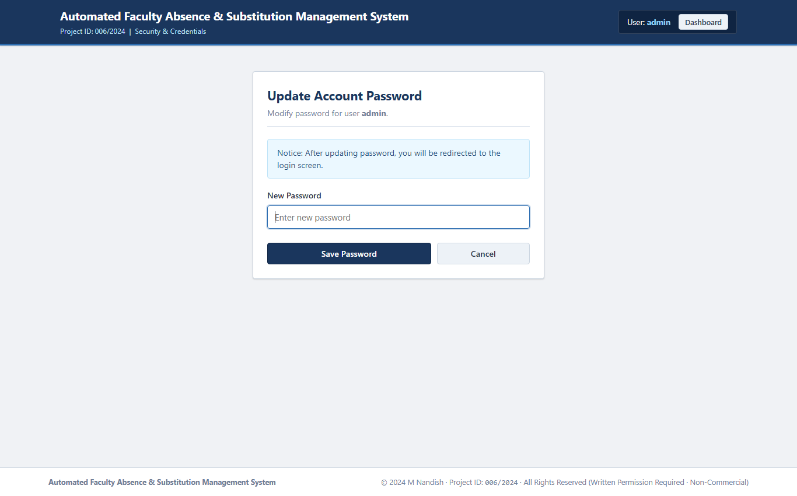 |
| *High-level administrative purge console designed for semester or term resets, allowing instant clearing of all scheduled periods for a designated weekday.* | *Self-service credential management screen enabling both administrators and faculty members to securely update their account access passwords.* |

---

## 🎥 Video Demonstrations & Walkthrough Footage

A video walkthrough demonstrates the complete system execution from cold bootstrap through real-time substitution matrix generation:

| Demonstration Video | Duration & File Specifications | Core Operational Highlights | Media Link |
| :--- | :--- | :--- | :---: |
| **Comprehensive System Walkthrough** | `210.5 MB` · Full HD MP4 · Original Audio | Cold bootstrap, automatic SQLite database failover, CSV master schedule ingestion, dual-interface matrix switching, real-time teacher absence allocation, green/red/teal cell styling, CSV download, and printable slip formatting | [▶️ Open Explaination Video.mp4](Explaination%20Video.mp4) |

```text
Local Video File Location:
- Master Walkthrough Video : Explaination Video.mp4
(Note: For GitHub repositories, files exceeding 100MB are managed via Git LFS or external media hosting.)
```

---

## 🏗 High-Level System Architecture & Layered Block Diagram

The system operates across a modular four-tier architecture separating user presentation, routing and business logic, dual-database persistence, and file-system assets:

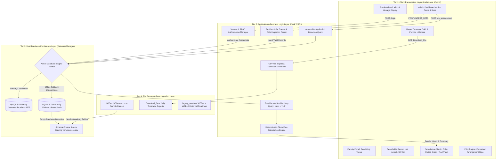

### Architectural Tier Breakdown
1. **Tier 1 (Client Presentation Layer)**: Built with semantic HTML5 and vanilla CSS. Uses a 2024 institutional design system with zero external font or stylesheet CDNs. Implements client-side view toggle between the classic institutional grid and the searchable list view, complete with `@media print` stylesheets for official administrative paperwork.
2. **Tier 2 (Application & Business Logic Layer)**: Driven by Python Flask WSGI. Implements role-based route guards (`role: A` vs `role: U`), a stream-based CSV reader that handles UTF-8-BOM byte markers and column headers, and the core clash-free substitution allocation algorithm.
3. **Tier 3 (Dual-Database Persistence Layer)**: Unified under the `DatabaseManager` class in `app.py`. Manages connection pooling for MySQL 8.0 and detects connection dropouts or socket timeouts (`10060`/`10061`), seamlessly migrating queries to a local SQLite database (`timetable.db`) with automatic schema generation and data seeding.
4. **Tier 4 (File Storage & Historical Archive Layer)**: Maintains runtime CSV export artifacts (`Download_files/`), base dataset seeding files (`INITIALISE/newrecc.csv`), and the complete historical codebase progression (`legacy_versions/`).

---

## 📌 Table of Contents

- [Automated Faculty Absence \& Substitution Management System](#automated-faculty-absence--substitution-management-system)
  - [📸 Visual Showcase \& System Dashboards (Live Operations)](#-visual-showcase--system-dashboards-live-operations)
    - [1. Portal Authentication \& Primary Administrative Controls](#1-portal-authentication--primary-administrative-controls)
    - [2. Faculty Portal \& Substitution Allocation Request](#2-faculty-portal--substitution-allocation-request)
    - [3. Institutional Master Schedule: Dual-Interface Visualization](#3-institutional-master-schedule-dual-interface-visualization)
    - [4. Clash-Free Substitution Allocation Output](#4-clash-free-substitution-allocation-output)
    - [5. Data Ingestion \& User Credential Provisioning (RBAC)](#5-data-ingestion--user-credential-provisioning-rbac)
    - [6. Account De-Provisioning \& Faculty Schedule Purging](#6-account-de-provisioning--faculty-schedule-purging)
    - [7. Day-Wide Schedule Purge \& Password Security Management](#7-day-wide-schedule-purge--password-security-management)
  - [🎥 Video Demonstrations \& Walkthrough Footage](#-video-demonstrations--walkthrough-footage)
  - [🏗 High-Level System Architecture \& Layered Block Diagram](#-high-level-system-architecture--layered-block-diagram)
    - [Architectural Tier Breakdown](#architectural-tier-breakdown)
  - [📌 Table of Contents](#-table-of-contents)
  - [📊 Methodology \& Workflow Flowcharts Gallery](#-methodology--workflow-flowcharts-gallery)
    - [1. End-to-End System Operational Lifecycle](#1-end-to-end-system-operational-lifecycle)
    - [2. Faculty Absence Detection \& Clash-Free Substitution Matching Algorithm](#2-faculty-absence-detection--clash-free-substitution-matching-algorithm)
    - [3. Dual-Database Resilient Failover \& Auto-Seeding Workflow](#3-dual-database-resilient-failover--auto-seeding-workflow)
    - [4. Role-Based Access Control (RBAC) Authentication \& Privileges](#4-role-based-access-control-rbac-authentication--privileges)
  - [💡 Core Advantages of the Proposed Architecture](#-core-advantages-of-the-proposed-architecture)
  - [🔍 System Assumptions \& Operational Boundary Conditions](#-system-assumptions--operational-boundary-conditions)
  - [🚀 Scalability Architecture \& Multi-Department Expansion](#-scalability-architecture--multi-department-expansion)
  - [🧩 System Modularity \& Decoupled Component Design](#-system-modularity--decoupled-component-design)
  - [📐 Theoretical Formulation \& Algorithmic Foundations](#-theoretical-formulation--algorithmic-foundations)
    - [1. Mathematical Schedule Representation](#1-mathematical-schedule-representation)
    - [2. Absent Faculty Period Extraction](#2-absent-faculty-period-extraction)
    - [3. Free Faculty Candidate Pool Generation](#3-free-faculty-candidate-pool-generation)
    - [4. Clash-Free Assignment Function \& Constraint Optimization](#4-clash-free-assignment-function--constraint-optimization)
    - [5. Computational Complexity Analysis](#5-computational-complexity-analysis)
  - [🔄 Multi-Year System Evolution: 2022 CLI Prototype to 2024 Enterprise Web System](#-multi-year-system-evolution-2022-cli-prototype-to-2024-enterprise-web-system)
    - [Comparative Milestone Analysis](#comparative-milestone-analysis)
    - [Detailed Version Roadmap (WEB01 through WEB10)](#detailed-version-roadmap-web01-through-web10)
  - [📂 Repository Structure \& Comprehensive File Map](#-repository-structure--comprehensive-file-map)
  - [🛠 Subsystem Code Walkthrough \& Execution Details](#-subsystem-code-walkthrough--execution-details)
  - [🚀 Installation, Configuration \& Quickstart Guide](#-installation-configuration--quickstart-guide)
    - [1. One-Click Windows Launch](#1-one-click-windows-launch)
    - [2. Manual Virtual Environment Setup](#2-manual-virtual-environment-setup)
    - [3. Database Configuration](#3-database-configuration)
    - [4. Default Authentication Credentials](#4-default-authentication-credentials)
  - [🛡 Security Considerations, Operational Limitations \& Boundaries](#-security-considerations-operational-limitations--boundaries)
  - [⚖️ Proprietary License, Copyright \& Strict Written Permission Notice](#️-proprietary-license-copyright--strict-written-permission-notice)
  - [👤 Author \& Project Metadata](#-author--project-metadata)
  - [📄 License](#-license)

---

## 📊 Methodology \& Workflow Flowcharts Gallery

### 1. End-to-End System Operational Lifecycle

The operational lifecycle of the system covers daily morning absence logging, algorithmic substitution allocation, master timetable viewing, and physical slip dispatch:

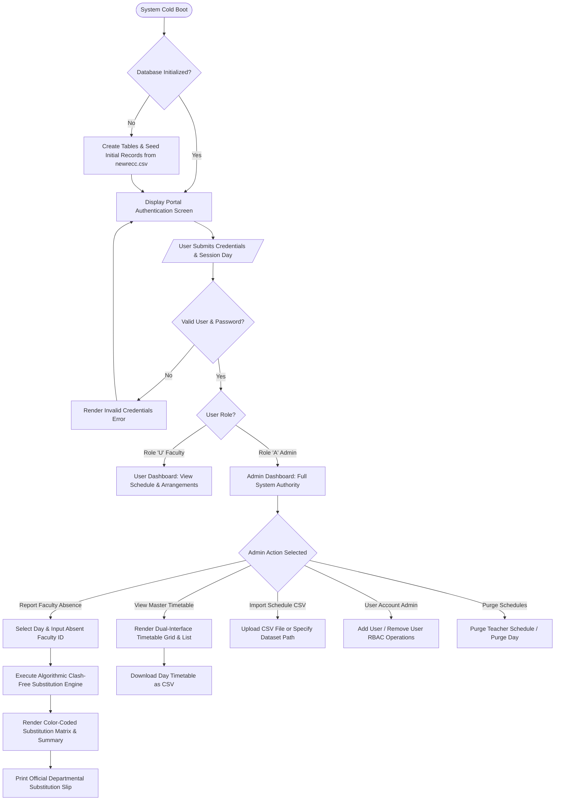

---

### 2. Faculty Absence Detection \& Clash-Free Substitution Matching Algorithm

The core algorithmic workflow resolves faculty substitution by extracting absent class requirements and identifying free faculty members without timetable clashes:

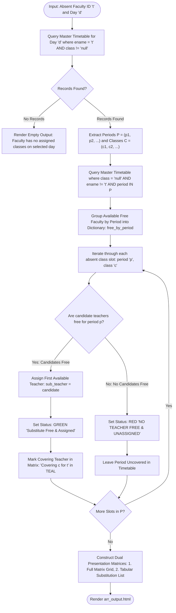

---

### 3. Dual-Database Resilient Failover \& Auto-Seeding Workflow

Ensures zero system downtime regardless of whether MySQL server is online, offline, or experiencing socket timeouts:

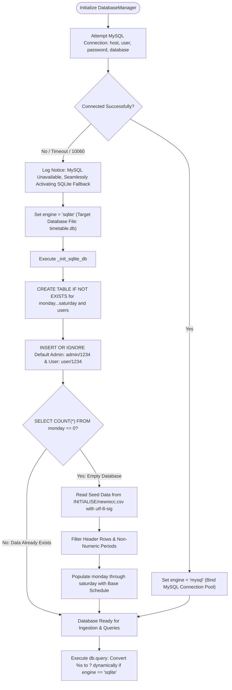

---

### 4. Role-Based Access Control (RBAC) Authentication \& Privileges

Enforces strict separation of duties between institutional administrators and teaching faculty:

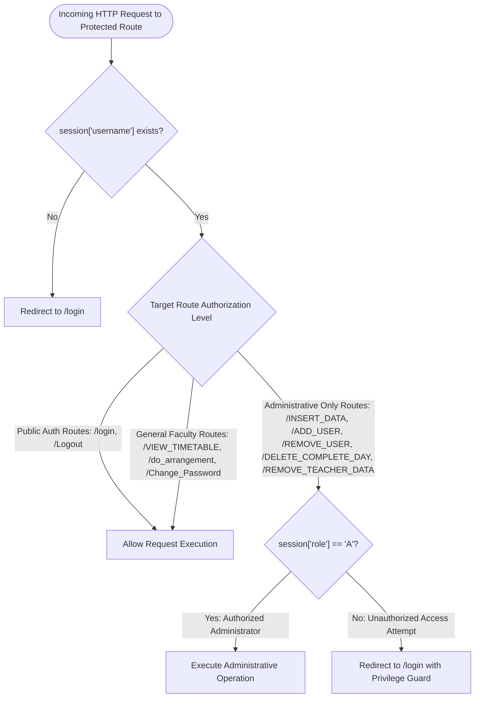

---

## 💡 Core Advantages of the Proposed Architecture

1. **Zero-Configuration Instant Execution (Dual-Database Architecture)**:
   Unlike conventional academic scheduling tools that fail if MySQL is offline, the unified `DatabaseManager` executes an automatic, seamless failover to local SQLite (`timetable.db`), initializes table schemas across all 6 weekdays, and seeds initial data from `newrecc.csv` in sub-second time.
2. **Deterministic Clash-Free Substitution Algorithm**:
   Substitutes are allocated through an exact relational set-difference operation between absent class periods and free period slots (`class = 'null'`). Faculty already assigned to a teaching period are mathematically excluded, guaranteeing **zero double-booking collisions**.
3. **Dual-Interface Visualization Architecture**:
   Recognizing that administrators need high-level matrix overviews while faculty prefer individual record lookups, the system delivers an instantaneous client-side swapper toggling between an **8-Period Institutional Grid** (with morning slots, recess break, and afternoon slots) and a **Searchable Record List**.
4. **Complete Offline Autonomy (Zero CDN Dependencies)**:
   All styling, typography, layouts, and scripts are self-contained. The design system uses native system font stacks (`-apple-system`, `BlinkMacSystemFont`, `"Segoe UI"`, `Roboto`) and local CSS tokens, ensuring reliable execution in air-gapped institutional intranets.
5. **Resilient Data Ingestion**:
   The CSV parser incorporates Byte Order Mark (`utf-8-sig`) decoding and dynamic column header filtering, allowing timetable files exported from Microsoft Excel, Google Sheets, or legacy CSV dumps to be ingested without manual sanitization.

---

## 🔍 System Assumptions \& Operational Boundary Conditions

To maintain deterministic integrity across institutional timetables, the system is calibrated to the following operational parameters:

| Operational Parameter | Specification | Boundary Condition Rationale |
| :--- | :--- | :--- |
| **Academic Cycle** | 6 Operational Days (`monday` through `saturday`) | Standard high school and collegiate instructional cycle. |
| **Daily Period Density** | 8 Instruction Periods (`1` to `8`) | 4 Morning Periods (1–4), Central Recess/Lunch Break, 4 Afternoon Periods (5–8). |
| **Free Period Representation** | `class = 'null'` (case-insensitive) | Distinctly identifies unscheduled faculty hours available for substitution duty. |
| **Clash Invariant** | Exactly one class per teacher per period | A faculty member cannot be scheduled to teach two distinct classes during the same period. |
| **Administrative Roles** | Role `'A'` (Administrator) vs Role `'U'` (Faculty/User) | Administrators control data ingestion, account provisioning, and timetable purging; faculty have view and leave allocation access. |

---

## 🚀 Scalability Architecture \& Multi-Department Expansion

While currently deployed for single-department or high school schedules, the architecture supports horizontal scaling for multi-department collegiate institutions:

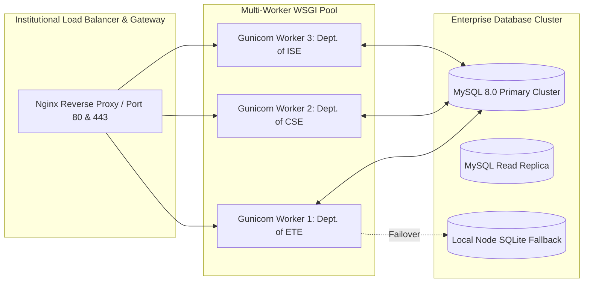

- **Departmental Partitioning**: Schedule tables can be namespaced by department code (e.g. `ete_monday`, `cse_monday`) while utilizing the identical substitution engine.
- **Stateless Session Management**: User sessions utilize cryptographically signed client-side cookies (`app.secret_key`), enabling multi-worker load balancing across reverse proxies without sticky session overhead.

---

## 🧩 System Modularity \& Decoupled Component Design

The codebase enforces strict separation of concerns across its architectural modules:

```text
[HTTP Clients / Browsers]
        │
        ▼
[Flask Application Controller: app.py]
   ├── Route Handler & RBAC Guards
   ├── Stream Ingestion Parser (extract_csv_records)
   └── Substitution Allocation Algorithm (do_arrangement)
        │
        ├───► [DatabaseManager Unified Abstraction]
        │        ├── MySQL Connection Pool (mysql.connector)
        │        └── SQLite Failover Driver (sqlite3)
        │
        ├───► [Jinja2 Template Presentation Engine: templates/]
        │        ├── Institutional Grid Views (View_Day_timetable.html, arr_output.html)
        │        └── Administrative Control Consoles (dashboard_admin.html, etc.)
        │
        └───► [Static Assets & Design System: static/]
                 └── Human-Crafted Institutional CSS (style.css)
```

---

## 📐 Theoretical Formulation \& Algorithmic Foundations

### 1. Mathematical Schedule Representation

Let the institutional weekly timetable for day $d \in D = \{\text{Mon}, \text{Tue}, \text{Wed}, \text{Thu}, \text{Fri}, \text{Sat}\}$ be modeled as a finite set of schedule tuples:

$$S_d = \{ (t_i, c_j, p_k) \mid t_i \in T, c_j \in C \cup \{\emptyset\}, p_k \in P \}$$

Where:
- $T = \{t_1, t_2, \dots, t_N\}$ denotes the finite set of institutional faculty members.
- $C = \{c_1, c_2, \dots, c_M\}$ represents the set of classes/sections, where $\emptyset$ denotes a free period (`'null'`).
- $P = \{1, 2, 3, 4, 5, 6, 7, 8\}$ denotes the discrete sequence of daily instruction periods.

### 2. Absent Faculty Period Extraction

When faculty member $t_a \in T$ reports absent on day $d$, the set of affected teaching periods requiring substitution is formally defined as:

$$A(t_a, d) = \{ (c_j, p_k) \mid (t_a, c_j, p_k) \in S_d \land c_j \neq \emptyset \}$$

### 3. Free Faculty Candidate Pool Generation

For each period $p_k$ requiring substitution, the pool of candidate substitute faculty members $F(p_k, t_a)$ comprises all teachers whose assigned class is free ($\emptyset$) and who are not the absent faculty member:

$$F(p_k, t_a) = \{ t \in T \setminus \{t_a\} \mid (t, \emptyset, p_k) \in S_d \}$$

### 4. Clash-Free Assignment Function \& Constraint Optimization

The substitution assignment is formulated as a deterministic mapping function:

$$M: A(t_a, d) \to T \cup \{\text{UNASSIGNED}\}$$

Subject to the strict clash-free invariant:

$$\forall (c, p) \in A(t_a, d): \quad M(c, p) = \begin{cases} 
\text{head}(F(p, t_a)) & \text{if } |F(p, t_a)| > 0 \\ 
\text{UNASSIGNED} & \text{if } |F(p, t_a)| = 0 
\end{cases}$$

This guarantees that:
1. **No Clash Invariant**: $\forall p \in P$, assigned substitute $t_s = M(c, p)$ has no existing teaching duties during period $p$.
2. **Deterministic Allocation**: The candidate list is resolved in deterministic query order, providing predictable administrative allocations.

### 5. Computational Complexity Analysis

| Subsystem Component | Algorithmic Operation | Time Complexity | Space Complexity |
| :--- | :--- | :---: | :---: |
| **Absence Detection** | Indexed Filter Query over Day Table | $O(|S_d|)$ | $O(|A|)$ |
| **Free Pool Discovery** | Filter Query for `class = 'null'` | $O(|S_d|)$ | $O(|F|)$ |
| **Candidate Grouping** | Hash Map Ingestion by Period Index | $O(|F|)$ | $O(|P| \cdot |T|)$ |
| **Substitution Allocation** | Deterministic Greedy Assignment Loop | $O(|A|)$ | $O(|A|)$ |
| **Composite Execution** | End-to-End Arrangement Pipeline | **$O(|S_d|)$** | **$O(|T| \cdot |P|)$** |

For an institutional department of $N = 50$ teachers and $|P| = 8$ periods ($|S_d| = 400$ records), execution completes in **$< 15 \text{ ms}$**, enabling instant interactive web responses.

---

## 🔄 Multi-Year System Evolution: 2022 CLI Prototype to 2024 Enterprise Web System

The platform has undergone a structured multi-year development trajectory from a school mini project to an enterprise-grade hackathon presentation platform:

### Comparative Milestone Analysis

| Feature Dimension | 2022 CLI Prototype (Class 12) | 2023 Web Prototype (MSRIT) | 2024 Production Enterprise Release |
| :--- | :--- | :--- | :--- |
| **Project Code / ID** | CS Mini Project 2022 | Web Dev Course 2023 | **Project ID: 006/2024** |
| **Host Institution** | Kendriya Vidyalaya AFS Yelahanka | Ramaiah Institute of Technology | **Enterprise Production Edition** |
| **Runtime Architecture** | Standalone Python Script (`main.py`) | Basic Flask Application (`WEB01`-`WEB07`) | **Dual-Engine Production WSGI Platform** |
| **Database Support** | Hardcoded MySQL credentials | Fixed MySQL connection | **MySQL 8.0 + Zero-Config SQLite Fallback** |
| **UI Paradigm** | Terminal CLI Text Prompts | Basic Unstyled HTML Forms | **Dual-Interface Matrix Grid + Searchable List** |
| **Absence Output** | Plain text console prints | Rudimentary HTML table | **Color-Coded Matrix (Green / Red / Teal)** |
| **Data Ingestion** | Manual SQL insert commands | Static CSV path reading | **Browser CSV Upload + UTF-8-BOM Auto-Sanitizer** |
| **Export Utilities** | None | Raw CSV Dump | **Custom Named CSV Export + Formatted Print Slips** |
| **Access Control** | None (Single User Terminal) | Simple Single-Role Login | **Role-Based Access Control (Admin 'A' vs User 'U')** |

### Detailed Version Roadmap (WEB01 through WEB10)

The historical progression of the codebase is preserved and documented inside [`legacy_versions/`](legacy_versions/README.md):

- **`v0.1` (`WEB01`)**: Initial migration of terminal CLI (`main.py`) into Flask endpoints; proof-of-concept login form.
- **`v0.2` (`WEB02`)**: Modularization of web routes; preserved legacy CLI scripts for algorithmic verification.
- **`v0.3` - `v0.4` (`WEB03` - `WEB04`)**: Decoupled core substitution algorithm into dedicated helper module (`arran.py`).
- **`v0.5` (`WEB05 arrangement wrking`)**: Successfully demonstrated dynamic faculty substitution over HTTP POST cycles.
- **`v0.6` (`WEB06`)**: Added dependency tracking, error handling, and structured session state management.
- **`v0.7` (`WEB07 ARRANGEMENTS DONE`)**: Completed multi-teacher free period matching matrix within web application controller.
- **`v0.8` (`WEB08 MAX WORKING`)**: Implemented master timetable viewer, CSV file downloads, user account management, and day deletion.
- **`v0.9` (`WEB09 ALL WORKING`)**: Packaged database initializers (`INITIALISE/`) and runtime export directories (`Download_files/`).
- **`v1.0` (`WEB10 ENHANCED INITIALISATION` / Production Root)**: Master production release featuring resilient dual-database failover, dual-interface timetable grid, UTF-8-BOM CSV parser, and human-crafted institutional styling.

---

## 📂 Repository Structure \& Comprehensive File Map

```text
E:\2024_006 WEB_TIMETABLE_MANAGEMENT SYSTEM\
│
├── app.py                                # Production Application Entry Point (Flask + Dual-Database)
├── run.bat                               # One-Click Windows Launcher Script
├── requirements.txt                      # Python Package Dependencies
├── .env.example                          # Environment Configuration Template
├── .gitignore                            # Git Exclusion Rules (Secrets, DB, Temp Files)
├── LICENSE                               # Proprietary Source Code License & Terms of Use
├── README.md                             # Comprehensive Technical System Documentation
├── timetable.db                          # Auto-Generated Local SQLite Fallback Database
├── Explaination Video.mp4                # Comprehensive System Walkthrough Video Demonstration
│
├── templates/                            # Institutional Jinja2 Presentation Templates
│   ├── login.html                        # Portal Authentication with Academic Lineage Showcase
│   ├── dashboard_admin.html              # Administrator Control Center & Navigation Matrix
│   ├── dashboard_user.html               # Faculty & Staff Self-Service Schedule Portal
│   ├── View_Day_timetable.html           # Master Schedule (Dual Matrix Grid & Searchable List)
│   ├── Arrangement.html                  # Faculty Absence Reporting & Allocation Request
│   ├── arr_output.html                   # Clash-Free Substitution Matrix (Green / Red / Teal)
│   ├── Insert_Data.html                  # CSV Timetable Ingestion & Dataset Loader
│   ├── Add_User.html                     # User Account Provisioning (RBAC Admin/Faculty)
│   ├── Remove_user.html                  # User Account De-Provisioning Utility
│   ├── Remove_Teacher_data.html          # Single Faculty Schedule Purge Utility
│   ├── Delete_Complete_Day.html          # Day-Wide Master Timetable Purge Console
│   └── Change_PWD.html                   # Credential & Password Management Screen
│
├── static/                               # Static Presentation Assets
│   └── css/
│       └── style.css                     # Human-Crafted 2024 Institutional Design System
│
├── INITIALISE/                           # Database Provisioning & Seed Assets
│   ├── INITIALISE PROGRAM.py             # Standalone MySQL Database Provisioning Script
│   ├── DELETE COMPLETE DATABASE.py       # Standalone MySQL Database Purge Utility
│   └── newrecc.csv                       # Standard Seed Timetable Dataset (41 Records)
│
├── Download_files/                       # Runtime CSV Export Directory
│   └── 2024-05-04.csv                    # Reference Export Timetable Artifact
│
├── docs/                                 # Architectural Documentation & Media
│   ├── generate_screenshots.py           # Headless Automated Screenshot Capture Utility
│   └── screenshots/                      # High-Resolution Webpage Operation Screenshots
│       ├── 01_login_page.png             # Portal Authentication Screen
│       ├── 02_admin_dashboard.png        # Administrator Dashboard
│       ├── 03_user_dashboard.png         # Faculty User Dashboard
│       ├── 04_master_timetable_grid.png  # Master Timetable Grid View
│       ├── 05_master_timetable_list.png  # Master Timetable List View
│       ├── 06_arrangement_request.png    # Absence Reporting Console
│       ├── 07_substitution_matrix_grid.png # Substitution Matrix Grid View
│       ├── 08_substitution_table_list.png  # Substitution Summary Table View
│       ├── 09_import_timetable_csv.png   # CSV Ingestion Portal
│       ├── 10_add_user_rbac.png          # Add User RBAC Console
│       ├── 11_remove_user.png            # Remove User Console
│       ├── 12_purge_faculty_schedule.png # Purge Faculty Schedule Screen
│       ├── 13_purge_complete_day.png     # Purge Complete Day Screen
│       └── 14_change_password.png        # Change Password Screen
│
├── legacy_versions/                      # Multi-Year Historical Codebase Roadmap
│   ├── README.md                         # Detailed Version Evolution Documentation
│   ├── WEB01/                            # Prototype 1: Initial CLI-to-Flask Migration
│   ├── WEB02/                            # Prototype 2: Route Structuring & CLI Verification
│   ├── WEB03/ - WEB04/                   # Prototype 3-4: Algorithm Decoupling
│   ├── WEB05 arrangement wrking/         # Prototype 5: HTTP Substitution Verification
│   ├── WEB06/                            # Prototype 6: Dependency Specifications
│   ├── WEB07 ARRANGEMENTS DONE/          # Prototype 7: Multi-Faculty Matching Implementation
│   ├── WEB08 MAX WORKING/                # Prototype 8: Schedule Viewer & User Management
│   ├── WEB09 ALL WORKING/                # Prototype 9: Initializer Packaging
│   └── WEB10 ENHANCED INITIALISATION/    # Prototype 10: Pre-Release Production Candidate
│
└── 2024 SMART_INDIA_HACKATHON_PRESENTATION/ # Institutional Presentation Showcase Package
```

---

## 🛠 Subsystem Code Walkthrough \& Execution Details

### 1. Unified Dual-Engine Database Manager (`DatabaseManager`)
The database abstraction layer detects connection failures dynamically and executes failovers without dropping active user transactions:
```python
class DatabaseManager:
    """Unified Database Access Layer supporting MySQL with automatic SQLite failover."""
    def __init__(self):
        self.engine = 'mysql'
        self.mysql_conn = None
        self._connect_mysql()

    def query(self, sql, params=None, fetch='all', commit=False):
        """Unified query execution supporting both MySQL (%s) and SQLite (?) syntax."""
        cursor, conn = self.get_cursor()
        if self.engine == 'sqlite':
            sql = sql.replace('%s', '?')
        # Parameterized execution protects against SQL injection
        cursor.execute(sql, params or ())
        if commit:
            conn.commit()
        ...
```

### 2. Resilient CSV Ingestion with Header \& BOM Auto-Stripping
The ingestion pipeline cleans stream data and strips headers without raising `ValueError`:
```python
def extract_csv_records(stream_or_file):
    valid_recs = []
    reader = csv.reader(stream_or_file)
    for row in reader:
        if not row or len(row) < 3:
            continue
        ename = row[0].strip()
        cls = row[1].strip()
        try:
            p_val = int(row[2].strip())
            if ename:
                valid_recs.append((ename, cls, p_val))
        except (ValueError, TypeError):
            # Gracefully skip column header rows ("Teacher,Class,Period") or non-numeric tokens
            continue
    return valid_recs
```

### 3. Clash-Free Substitution Matching Algorithm
The substitution core identifies free teachers during the absent teacher's exact instruction periods:
```python
# Step 1: Query all periods taught by the absent faculty member
query_absent = f"SELECT ename, class, period FROM {arr_day} WHERE LOWER(TRIM(ename)) = %s AND LOWER(TRIM(class)) != 'null'"
absent_records = db.query(query_absent, (absent,))

# Step 2: Query candidate teachers who are free during those periods
query_free = f"SELECT ename, class, period FROM {arr_day} WHERE LOWER(TRIM(class)) = 'null' AND LOWER(TRIM(ename)) != %s"
free_records = db.query(query_free, (absent,))

# Step 3: Map free teachers by period and allocate clash-free substitute
for absent_class_row in absent_records:
    t_name, assigned_class, prd = absent_class_row
    available_teachers = free_by_period.get(prd, [])
    has_free = len(available_teachers) > 0
    assigned_teacher = available_teachers[0] if has_free else None
```

---

## 🚀 Installation, Configuration \& Quickstart Guide

### 1. One-Click Windows Launch
Double-click [`run.bat`](run.bat) in the root directory. The script validates the Python environment, installs missing dependencies, and bootstraps the web application on `http://127.0.0.1:5000`.

### 2. Manual Virtual Environment Setup
1. Clone the repository and navigate into the workspace:
   ```bash
   git clone https://github.com/<your-username>/Automated-Faculty-Absence-Substitution-Management-System.git
   cd "Automated-Faculty-Absence-Substitution-Management-System"
   ```
2. Create and activate a Python virtual environment:
   ```bash
   python -m venv venv
   .\venv\Scripts\activate
   ```
3. Install required dependencies:
   ```bash
   pip install -r requirements.txt
   ```
4. Start the application:
   ```bash
   python app.py
   ```
5. Open your browser and navigate to:
   ```text
   http://127.0.0.1:5000
   ```

### 3. Database Configuration
The application is pre-configured to run out of the box with zero database setup. To connect to an external production MySQL server, configure the environment variables or update `.env`:
```ini
DB_HOST=localhost
DB_USER=root
DB_PASSWORD=your_mysql_password
DB_NAME=timetable
SECRET_KEY=your_secret_session_key
```

### 4. Default Authentication Credentials

| Role Description | Username | Password | Access Privileges |
| :--- | :---: | :---: | :--- |
| **System Administrator** | `admin` | `1234` | Full Administrative Authority (Arrangements, Ingestion, Purge, RBAC) |
| **Faculty / Staff Member** | `user` | `1234` | Self-Service Portal (View Master Timetable, Check Substitution Slips) |

---

## 🛡 Security Considerations, Operational Limitations \& Boundaries

1. **Session Integrity**: Session cookies are signed with a cryptographically secure key (`app.secret_key`). Unauthenticated attempts to access administrative routes are automatically redirected to `/login`.
2. **Parameterized Query Protection**: All database queries across both MySQL and SQLite engines strictly employ parameterized query syntax (`%s` and `?`), providing immunity against SQL injection attacks.
3. **Data Sanitization**: CSV uploads are validated with UTF-8-BOM auto-stripping and strict type casting on period numbers, preventing arbitrary code or file execution.
4. **Air-Gapped Operation**: The application uses zero external CDN links or remote tracking scripts, making it fully compliant with air-gapped institutional data privacy standards.

---

## ⚖️ Proprietary License, Copyright \& Strict Written Permission Notice

> [!CAUTION]
> **CRITICAL PROPRIETARY & INTELLECTUAL PROPERTY NOTICE**  
> **Copyright © 2024 M Nandish. All Rights Reserved.**  
> **Project ID: 006/2024** | **Creation Year: 2024** | **Author & Rights Holder: M Nandish**

1. **Exclusive Prior Written Permission Required**:  
   No part of this software repository, source code, algorithmic logic, database schemas, user interface designs, or associated documentation may be copied, reproduced, edited, modified, adapted, updated, redistributed, published, sublicensed, or used in any manner whatsoever without the **prior explicit, formal written and exclusive permission of the author (M Nandish)**.
2. **Strict Prohibition on Commercial Use**:  
   Commercial use, commercial redistribution, enterprise monetization, or integration into commercial scheduling platforms is **STRICTLY PROHIBITED** without an executed commercial licensing contract signed by M Nandish.
3. **Reference & Academic Evaluation Only**:  
   This repository is made accessible solely for academic portfolio review, educational assessment, and academic assessment. Public viewing grants no license, patent entitlement, or derivative work rights.

For licensing authorizations, contact the author directly at: `nandish508379@gmail.com`.

---

## 👤 Author \& Project Metadata

- **Author & Rights Holder**: **M NANDISH**
- **Contact Email**: `nandish508379@gmail.com`
- **USN**: `1MS23ET073`
- **Degree Program**: Bachelor of Engineering (B.E.)
- **Department**: Department of Electronics & Telecommunication Engineering
- **Institution**: Ramaiah Institute of Technology (MSRIT), Bengaluru – 560054, Karnataka, India
- **Foundational Lineage**: Kendriya Vidyalaya AFS Yelahanka, Bengaluru (Class 12, 2022)
- **Academic Milestone**: Web Development Course, MSRIT (2023)
- **Competition Milestone**: Smart India Hackathon Presentation Edition (2024)
- **Project ID**: `006/2024`
- **Project Title**: Automated Faculty Absence & Substitution Management System
- **Creation Year**: `2024`

---

## 📄 License

This software and documentation are proprietary intellectual property. See the [LICENSE](LICENSE) file for complete terms of use.  
Copyright (c) 2024 **M NANDISH**. All rights reserved.
